<p align="center">
  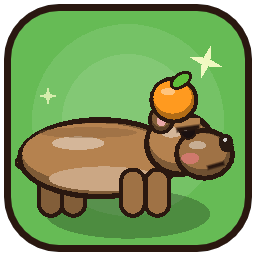
</p>

<h1 align="center">CAPIVARA CAOS</h1>
<p align="center"><i>ela só queria relaxar</i></p>

<p align="center">
  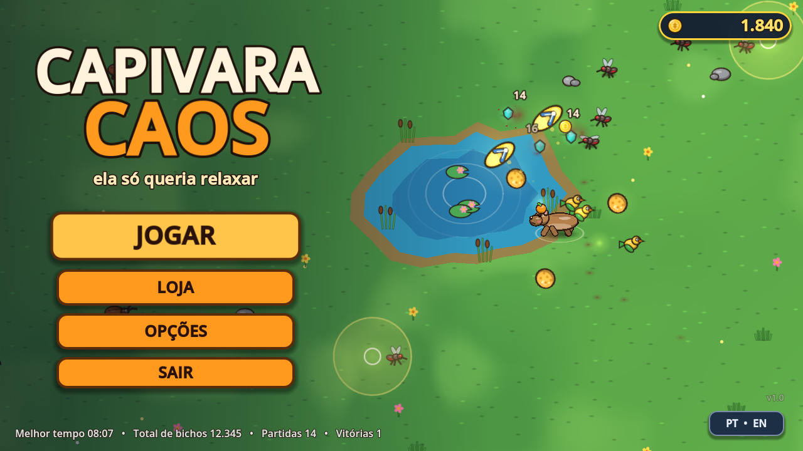
</p>

<p align="center">
  <b>Um survivors-like brasileiro feito em Godot 4.7.</b><br>
  GDScript · arte e áudio 100% gerados por código · Windows · PT-BR / EN
</p>

Você é uma capivara chill com uma laranja na cabeça tentando relaxar no Pantanal enquanto hordas de mosquitos,
baratas voadoras, ratos, sapos, gambás, um jacaré rabugento, uma onça e uma **sucuri gigante** tentam te atrapalhar.
Você só se mexe: as armas atiram sozinhas. Sobreviva **10 minutos** e derrote a Sucuri.

Tudo é original e gerado por código: a arte é vetorial (desenhada em GDScript e assada num atlas),
o áudio é sintetizado (numpy rodando dentro do Python embutido do Blender). Zero arquivos baixados.

---

## 📸 Prints

<table>
  <tr>
    <td width="50%">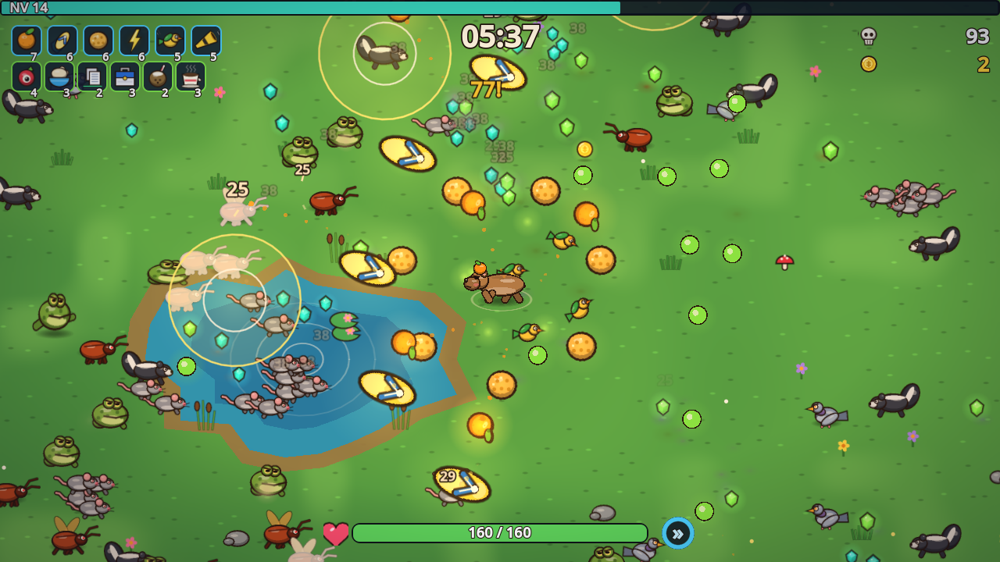<br><sub><b>Gameplay:</b> armas automáticas, lagoas que curam a capivara e uma horda a caminho.</sub></td>
    <td width="50%">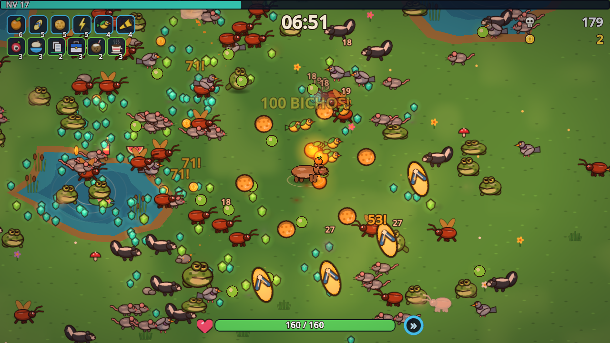<br><sub><b>Caos:</b> a horda cresce a cada minuto e o dia vira tarde, depois noite.</sub></td>
  </tr>
  <tr>
    <td>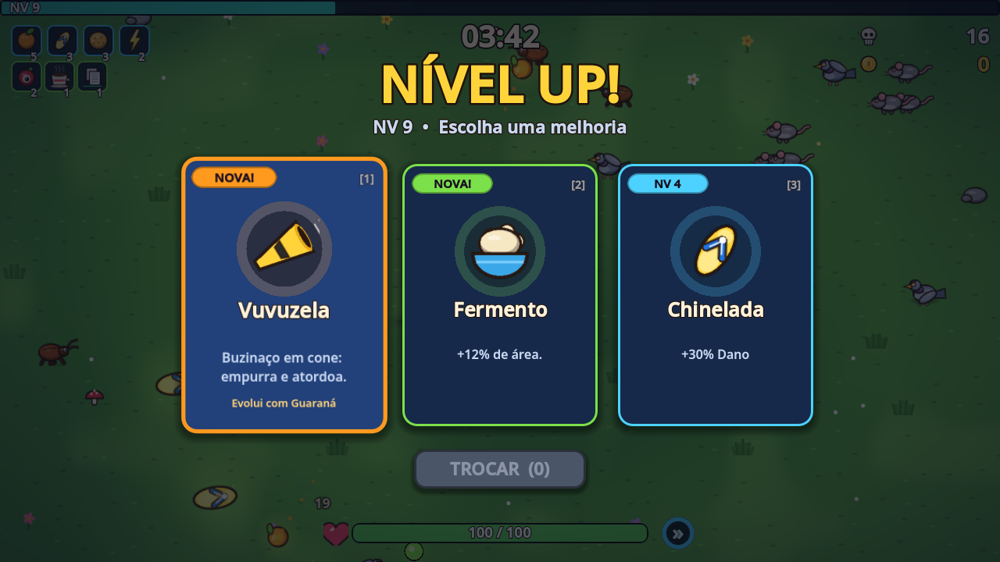<br><sub><b>Level-up:</b> arma nova, melhoria ou item (teclas 1/2/3, mouse ou controle).</sub></td>
    <td>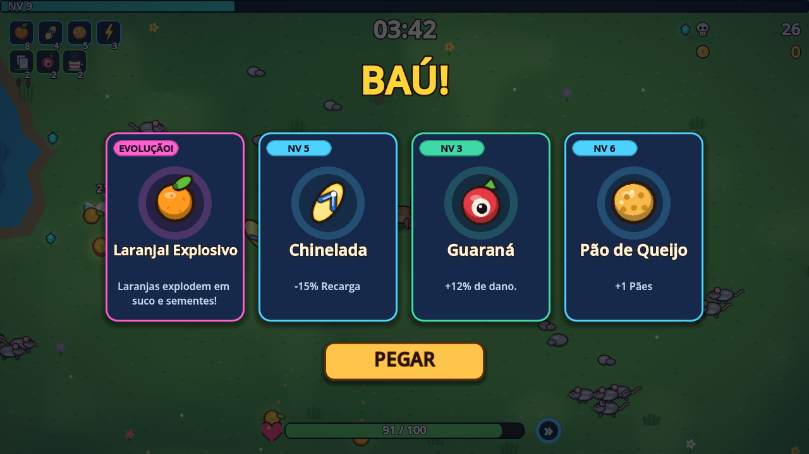<br><sub><b>Baú de elite:</b> arma no nível máximo + o item certo = <b>evolução</b>.</sub></td>
  </tr>
  <tr>
    <td>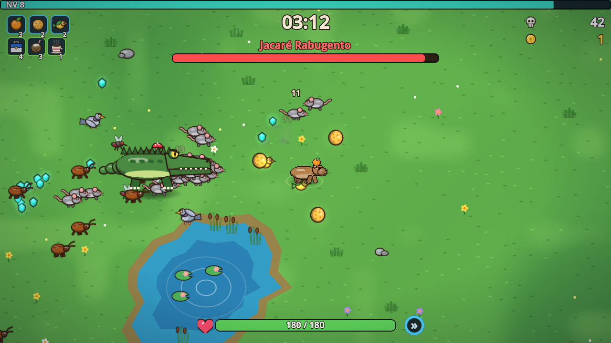<br><sub><b>3:00</b> — o Jacaré Rabugento.</sub></td>
    <td>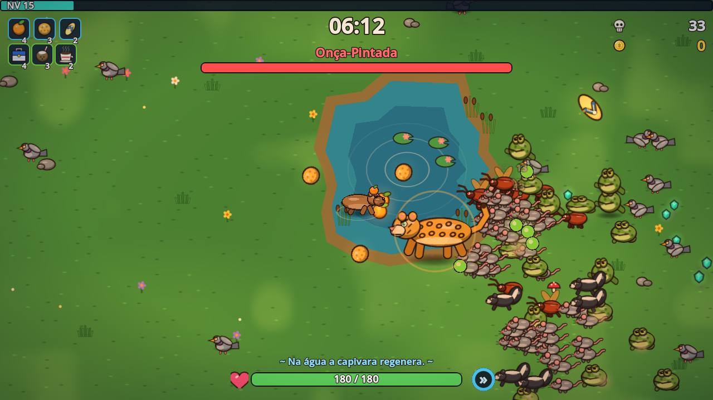<br><sub><b>6:00</b> — a Onça-pintada (na lagoa a capivara regenera vida).</sub></td>
  </tr>
  <tr>
    <td colspan="2">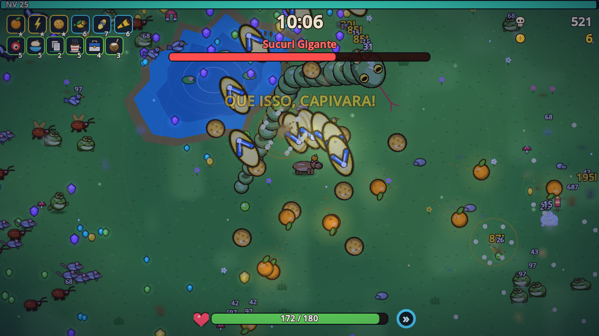<br><sub><b>10:00</b> — a Sucuri Gigante, à noite. Derrote-a para vencer.</sub></td>
  </tr>
  <tr>
    <td>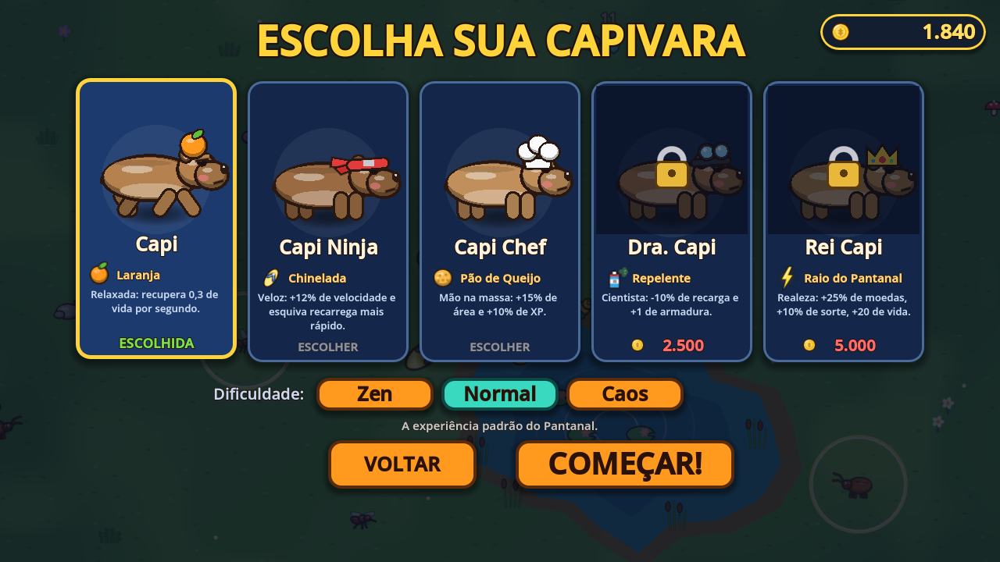<br><sub><b>5 capivaras</b>, cada uma com arma inicial e bônus próprios.</sub></td>
    <td>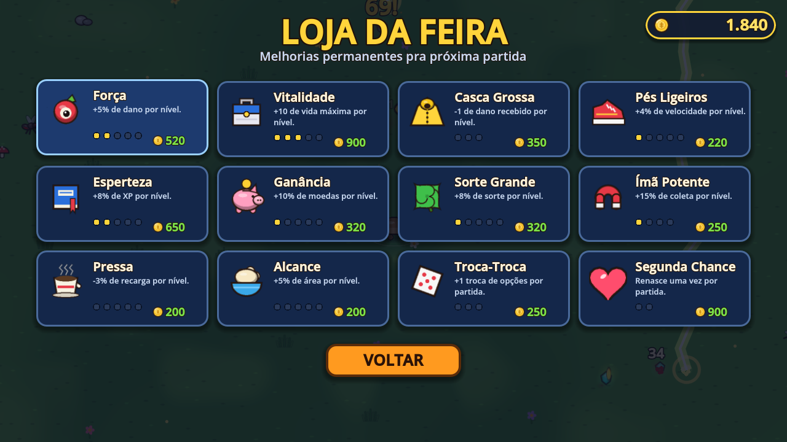<br><sub><b>Loja da Feira:</b> 12 melhorias permanentes pagas com as moedas das partidas.</sub></td>
  </tr>
</table>

---

## ▶ Como jogar

| Opção | O que fazer |
|---|---|
| **Pelo Godot instalado** | Dois cliques em `Jogar.bat` (procura o Godot em `C:\Godot`, no `PATH` ou na variável `GODOT_EXE`). Na primeira vez ele importa os recursos sozinho. |
| **Pelo editor** | Abra a pasta no Godot 4.7 e aperte **F5** (ou use `Editar no Godot.bat`). |
| **Pacote portátil** | Veja [Exportar](#-exportar): gera `CapivaraCaos.exe` + `.pck` que rodam sem Godot instalado. |

Funciona no renderer **Compatibility** (OpenGL 3.3), então roda até em PC modesto
(testado numa RX 550 + i5-4690K: 150+ FPS sem vsync com ~170 inimigos na tela).

## 🎮 Controles

| Ação | Teclado | Controle |
|---|---|---|
| Mover | `WASD` / setas | analógico esquerdo / direcional |
| Esquiva (dash com invulnerabilidade) | `Espaço` / `Shift` | `A` / `X` / `RB` |
| Pausar | `Esc` / `P` | `Start` |
| Trocar opções no level-up | `R` | `Y` |
| Escolher carta | `1` `2` `3`, setas + `Enter`, ou mouse | direcional + `A` |
| Tela cheia | `F11` | |
| Mostrar FPS | `F3` | |

**Dica de ouro:** esquivar *através* de um inimigo no último instante dispara a **Esquiva Perfeita**
(câmera lenta + XP bônus). E ficar na água regenera vida.

## 🧠 O jogo

- **8 armas** brasileiras, cada uma com 8 níveis: Laranja, Chinelada (bumerangue), Pão de Queijo (orbital),
  Repelente (aura, mosquito sofre em dobro), Raio do Pantanal, Banho de Lama, Vuvuzela e Passarinhos.
- **12 itens passivos** (Guaraná, Cafezinho, Tênis, Marmita, Capa de Chuva, Água de Coco, Ímã, Fermento,
  Xerox, Cursinho, Trevo, Cofrinho). Até 6 armas + 6 itens por partida.
- **Evoluções:** arma no nível máximo + o item certo → abra um **baú** (dropa de elites e chefes)
  e ela evolui (Laranjal Explosivo, Chinelão Épico, Fumacê, Tempestade Tropical, Spa de Lama...).
- **Chefões:** Jacaré (3:00), Onça-pintada (6:00) e a **Sucuri Gigante** (10:00), além de elites,
  eventos (enxames, fila de ratos, chuva de pombos, **BARATA VOADORA!**) e ciclo de dia → noite com vaga-lumes.
- **Meta-progressão:** moedas viram melhorias permanentes na **Loja da Feira** (12 itens) e desbloqueiam
  4 capivaras extras (Ninja, Chef, Doutora, Rei), cada uma com arma inicial e bônus próprios.
- **Dificuldades:** Zen (relaxante), Normal e Caos (+50% de moedas).
- **Modo infinito** depois de vencer, botão **Copiar resultado** (texto pronto pra postar) e PT-BR / EN.
- **Acessibilidade:** opções para desligar tremida de tela, números de dano e clarões.
- A tela inicial é o próprio jogo rodando sozinho (modo atração).

## 🗂 Estrutura

```
project.godot        configuração (autoloads G e Sfx, renderer Compatibility)
scenes/main.tscn     cena única; tudo é montado por código
scripts/
  main.gd            boot, atlas, título <-> partida, ferramentas de teste
  g.gd  sfx.gd       autoloads: save/idioma/inputs e áudio
  defs.gd            TODOS os dados: armas, itens, personagens, loja, inimigos, ondas, eventos
  art.gd capy.gd     arte vetorial (sprites, ícones, capivara, cobra) + baker.gd (atlas 2x)
  run.gd             a partida: loop, spawner, upgrades, baús, chefes, fim de jogo
  enemies.gd enemy.gd  IA, grade espacial, dano, desenho em lote
  weapon.gd weapons.gd proj.gd projs.gd  armas e projéteis
  pickups.gd fx.gd player.gd world.gd bot.gd hud.gd title.gd ui.gd
shaders/ground.gdshader   gramado infinito procedural
audio/               32 SFX + 3 músicas (gerados por tools/gen_audio.py)
tools/gen_audio.py   sintetizador de áudio
docs/screenshots/    os prints deste README (gerados pelo próprio jogo)
```

Para **mexer no balanceamento**, quase tudo está em `scripts/defs.gd` (HP, dano, ondas, tempos, preços).

## 🔊 Regerar o áudio

```
"C:\Program Files\Blender Foundation\Blender 5.2\blender.exe" -b --factory-startup --python tools/gen_audio.py -- .
```
Depois rode `godot --headless --import --path .` (os `.import` já estão configurados para PCM sem compressão e loop nas músicas).

## 🧪 Ferramentas de teste (argumentos depois de `--`)

```
godot --path . -- --bot --seconds=600 --steps=8        # bot joga sozinho (use --headless pra rodar rápido)
godot --path . -- --bot --char=ninja --skill=0.6 --diff=2 --t0=300
godot --path . -- --bot --idle --give=orange:8,xerox:2 --ui=chest --out=<pasta>   # screenshots de UI
godot --path . -- --flow                               # auto-teste de toda a navegação de menus
godot --path . -- --title-shot --page=shop --coins=900 --lang=en --out=<pasta>
```

**Como os prints do README foram feitos** (build exato, HUD limpo, sem som, janela fora da tela):

```
godot --path . --position 4000,2500 -- --bot --steps=1 --exact --clean --mute --skill=0.9 ^
      --t0=326 --give=orange:7,flipflop:6,cheese:6,thunder:6,birds:5,vuvuzela:5,guarana:4 ^
      --shots=337 --seconds=340 --out=docs/screenshots/_raw
godot --path . --position 4000,2500 -- --title-shot --page=select --progress --coins=1840 --mute --out=docs/screenshots/_raw
```
`--t0` pula para um ponto da partida, `--give` monta o build, `--shots` tira prints em segundos de jogo,
`--ui=levelup|chest|pause|over|win --ui-at=<s>` abre uma tela e fotografa, `--progress` simula um save intermediário (só na memória).

## 📦 Exportar

`export_presets.cfg` já tem os presets **Windows Desktop** e **Web**. Depois de instalar os *export templates*
(Editor → Gerenciar Modelos de Exportação) basta **Projeto → Exportar**.

**Pacote portátil sem templates:** o `.pck` com os dados do jogo, junto de uma cópia do executável do Godot
renomeada para o mesmo nome do `.pck`, roda sem Godot instalado:

```
godot --headless --import --path .
godot --headless --export-pack "Windows Desktop" build/CapivaraCaos/CapivaraCaos.pck
copy C:\Godot\Godot_v4.7.2-stable_win64.exe build\CapivaraCaos\CapivaraCaos.exe
```
A pasta `build/` **não é versionada** (o `.exe` tem ~170 MB). Compacte-a e publique o `.zip` em [*Releases*](https://github.com/EduBraga7/capivara-caos/releases).

## 🙌 Créditos

Feito com [Godot Engine](https://godotengine.org) (MIT). A fonte é a padrão do Godot (Open Sans, OFL).
Arte, código, músicas e efeitos são originais, gerados proceduralmente.
